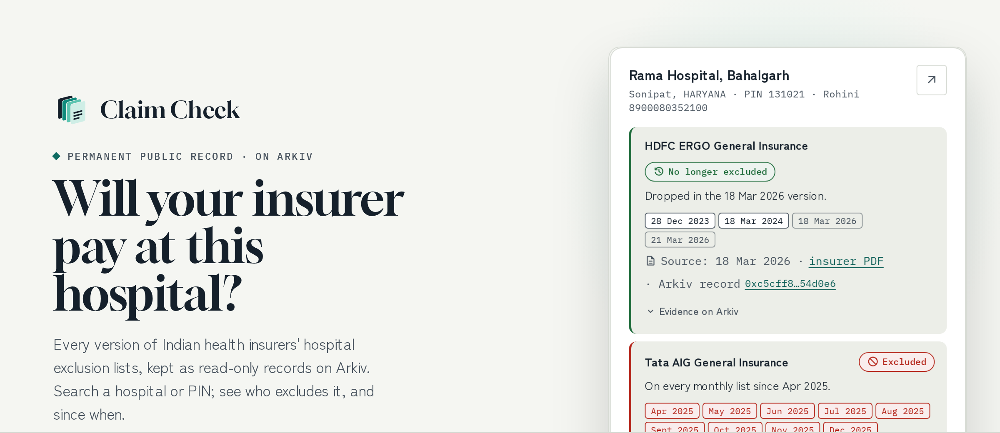
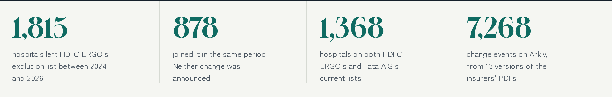
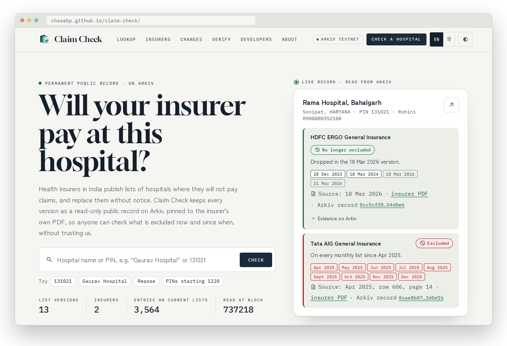
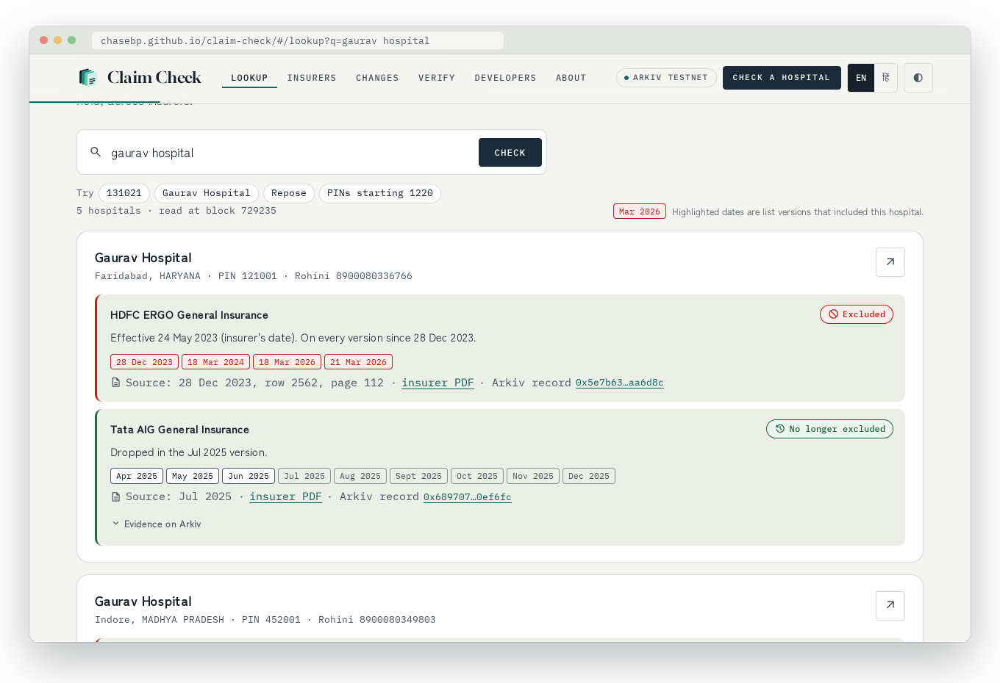
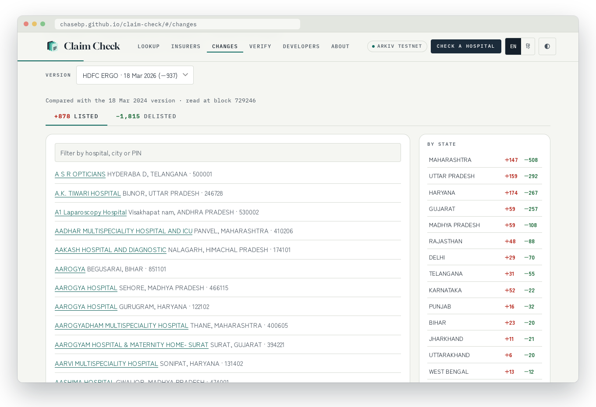
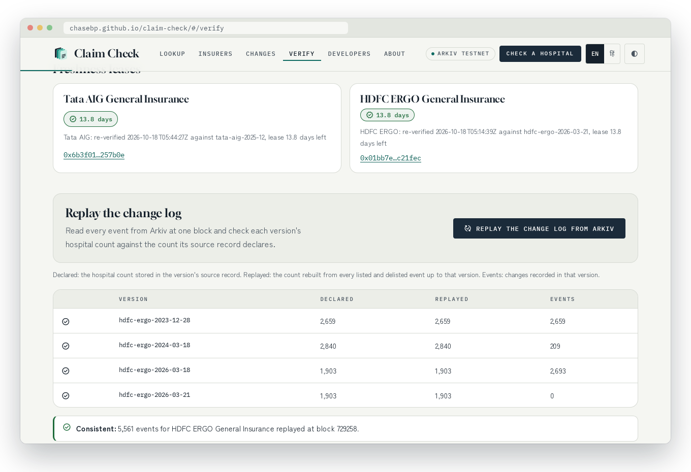
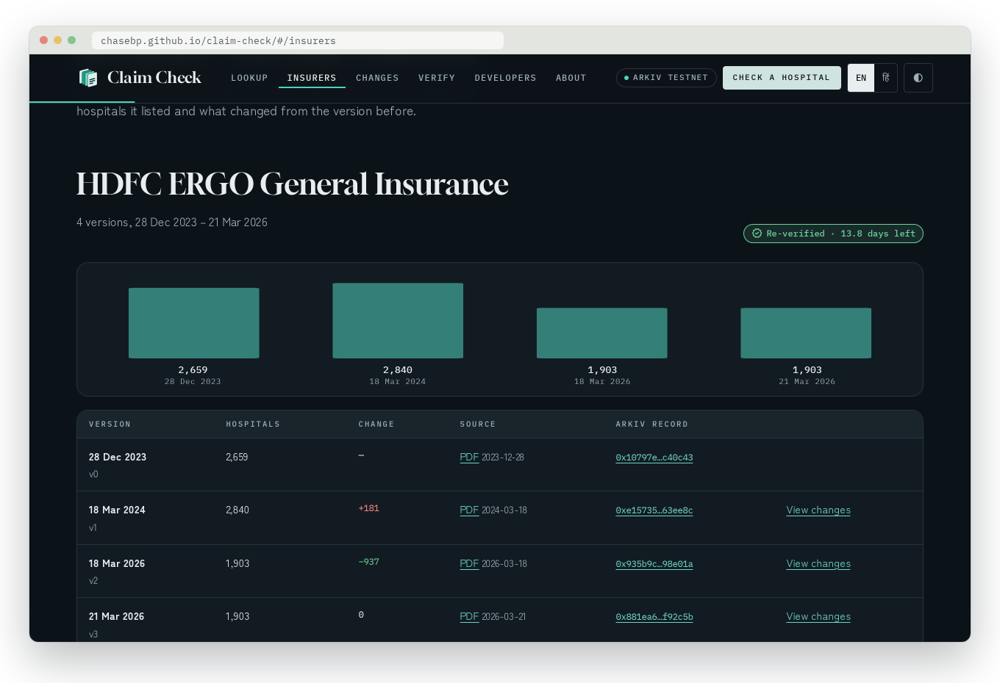
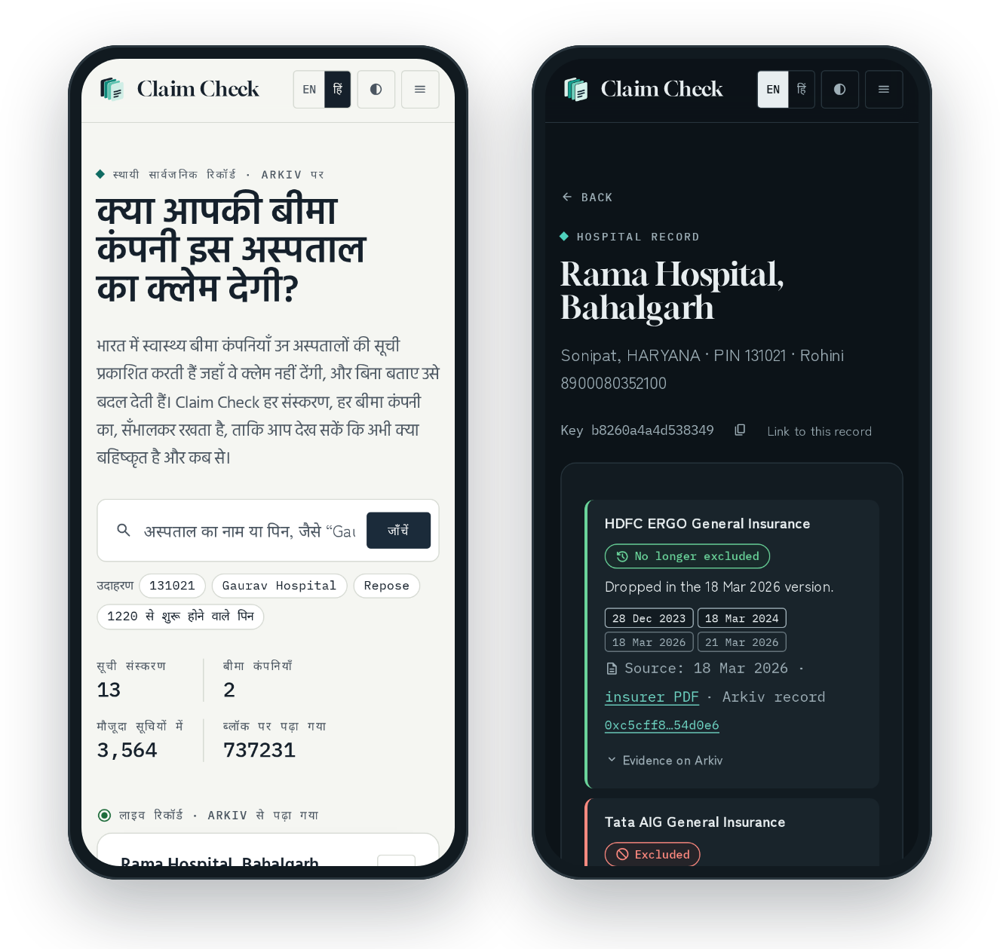
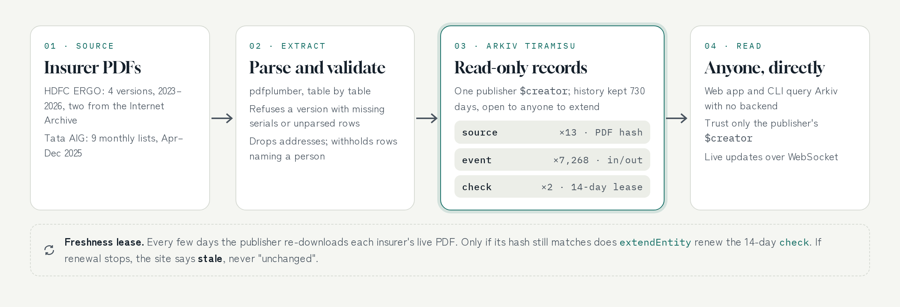

<p align="center">
  <a href="https://chasebp.github.io/claim-check/">
    <picture>
      <source media="(prefers-color-scheme: dark)" srcset="docs/img/banner-dark.png">
      
    </picture>
  </a>
</p>

<p align="center">
  <a href="https://chasebp.github.io/claim-check/"></a>
  <a href="https://www.youtube.com/watch?v=tjXqfRtgieg"></a>
  
  
  
</p>

<p align="center"><b><a href="https://chasebp.github.io/claim-check/">Open the app</a></b> · <a href="https://www.youtube.com/watch?v=tjXqfRtgieg">Watch the demo</a> · <a href="arkiv/schema.md">Schema</a> · <a href="arkiv/friction.md">Friction report</a></p>

---

## The problem

Indian health insurers keep lists of hospitals where they **will not pay a claim**, cashless or reimbursement, beyond stabilising an emergency. Since 2024 the industry's *Cashless Everywhere* scheme lets policyholders go cashless outside their insurer's network, but **not at a hospital the insurer has blacklisted**. So this list decides whether a family's planned surgery is paid.

The only notice is a PDF on the insurer's website, replaced without saying what changed:

<picture>
  <source media="(prefers-color-scheme: dark)" srcset="docs/img/facts-dark.png">
  
</picture>

<details>
<summary><b>More: the clause, the vanished versions, and why it differs by insurer</b></summary>

HDFC ERGO's list opens with the clause that makes it binding:

> Expenses incurred towards treatment in any hospital or by any Medical Practitioner or any other provider specifically excluded by the Insurer and disclosed in its website/notified to the Policyholders are not admissible. However, in case of Life Threatening Situations or following an Accident, expenses up to the stage of stabilization are payable but not the complete claim.

- **Replaced without notice.** The URL HDFC ERGO labels `exclusion-list-12-02-2025.pdf` now serves a file created on 18 March 2026.
- **No history.** The December 2023 and March 2024 lists survive only because the Internet Archive happened to capture them.
- **No search, no comparison.** Tata AIG posts a new PDF every month; between April and December 2025 it dropped 23 hospitals and added 2. Nothing says which.
- **Different per insurer.** Rama Hospital in Sonipat (PIN 131021) left HDFC ERGO's list in March 2026 and is still on Tata AIG's; Gaurav Hospital in Faridabad is the reverse.

**Who it is for:** a policyholder choosing a hospital for a planned admission, a relative checking a hospital a doctor referred them to, and journalists, consumer groups or hospitals who need to know when a listing began or ended.
</details>

## What it does

Search a hospital name or PIN and see, for each insurer, whether it is excluded **now**, **since when**, and on **which versions**, with the insurer's PDF row and the Arkiv record behind every answer. English and Hindi, light and dark.

<p align="center"><a href="https://chasebp.github.io/claim-check/"></a></p>

<table>
  <tr>
    <td width="50%"><br><b>Lookup.</b> One card per hospital, a row per insurer, a chip for every list version.</td>
    <td width="50%"><br><b>Changes.</b> What each version added and dropped, filterable, by state.</td>
  </tr>
  <tr>
    <td width="50%"><br><b>Verify.</b> Freshness leases, PDF hashes, and a replay of all 7,268 events from Arkiv.</td>
    <td width="50%"><br><b>Insurers.</b> Every version with its count, change, PDF and Arkiv record.</td>
  </tr>
</table>

<p align="center"></p>

<details>
<summary><b>Every page</b></summary>

- **Home:** the problem in real numbers, a live record, an interactive walk-through of how a list goes from PDF to Arkiv (every figure read live), recent changes, coverage and FAQ.
- **Lookup** by name, PIN or PIN prefix, across insurers.
- **Hospital pages** (`#/hospital/<key>`): a shareable record of one hospital, with the PDF row and Arkiv entity behind every change.
- **Insurers:** every version with hospital counts, change from the previous version, PDF links and Arkiv records.
- **Changes:** hospitals each version added and dropped, 50 at a time, filterable, by state.
- **Verify:** freshness leases, each version's SHA-256 and flags, and a replay of the whole change log against declared counts.
- **Developers:** the data contract, the exact queries, and CLI and curl recipes.
- **About:** why this exists, Cashless Everywhere, why Arkiv, methodology and limits.
- **Stale is a state, not a guess:** if re-verification stops, a 14-day lease on Arkiv expires and the app says *stale*. It never implies "unchanged" or "not excluded".
- **Any endpoint:** `?rpc=<url>` reads from any Arkiv RPC. There is no Claim Check server.
</details>

## How it works

<picture>
  <source media="(prefers-color-scheme: dark)" srcset="docs/img/how-dark.png">
  
</picture>

## Why Arkiv

If the history sat in our database, it would be exactly as trustworthy as our promise not to edit it, which is the very problem we are pointing at in the insurer.

| | Our own database | A Git repository | Internet Archive | **Arkiv** |
|---|---|---|---|---|
| History can be edited silently | Yes | Yes, by rewriting history | No | **No: records are read-only** |
| Readable without our servers | No | Yes, if a copy survives | Yes | **Yes, from any Arkiv endpoint** |
| Query by hospital or PIN | Yes | No | No | **Yes, typed attributes** |
| Shows who published each record | No | Only with signed commits | No | **Yes: `$creator` on every record** |
| Signals when data goes stale | No | No | No | **Yes: an expiring lease** |

| Arkiv feature | How Claim Check uses it |
|---|---|
| **`$creator`** | Readers keep only entities created by the publisher `0xE33A…b703`; anyone else's `claim-check` entities are ignored. |
| **Read-only entities** | A published version or event cannot be patched. A correction is a new, visible record. |
| **Permissionless extension** | Anyone can pay to keep the history queryable, without asking us. |
| **`extendEntity` as a lease** | `check` entities live 14 days and are renewed only after the live PDF's hash is re-verified. |
| **Typed attributes and queries** | `STARTSWITH` on PIN and name, `version` diffs, `OR` over hospital keys, pagination pinned with `atBlock`. |
| **WebSocket events** | Open pages refresh when the publisher writes or a lease is renewed. |
| **No backend** | The web app and CLI share one reader, [`shared/arkiv-read.js`](shared/arkiv-read.js), and query Arkiv directly. |

Kept off Arkiv on purpose: the PDFs (hashes and URLs only), street addresses, rows whose hospital name is a person's name (only their count), and anything about users. Full schema, lifetimes and queries: [`arkiv/schema.md`](arkiv/schema.md). What was hard: [`arkiv/friction.md`](arkiv/friction.md).

## Try it without the website

Node 18+ or Bun, nothing to install:

```bash
node cli/claim-check.mjs search 131021          # one PIN, both insurers
node cli/claim-check.mjs search "repose"        # by name prefix
node cli/claim-check.mjs sources                # versions, hashes, freshness leases
node cli/claim-check.mjs changes hdfc-ergo 2    # what the 18 Mar 2026 version changed
node cli/claim-check.mjs verify hdfc-ergo       # replay all events against declared counts
node cli/claim-check.mjs verify tata-aig
node cli/claim-check.mjs search 700019 --rpc <any-arkiv-endpoint>
```

<details>
<summary><b>Rebuild the data, run the app, publish</b></summary>

```bash
# Rebuild the change log from the insurers' PDFs
uv venv .venv && uv pip install --python .venv/bin/python pdfplumber==0.11.4
bun run extract            # downloads PDFs to .cache/, writes data/*.json and data/events.json

# Run the app locally
bun install && bun run dev

# Publish (needs a funded key), then renew the freshness lease
PUBLISHER_PRIVATE_KEY=0x… bun run publish:data
bun run check
```

Check a version's hash yourself: download the `source_url` from `data/<doc>.json` (or the Verify page) and run `sha256sum`; it must equal the `sha` attribute of that version's `source` entity.
</details>

## On-chain evidence

| | |
|---|---|
| **Publisher** | [`0xE33A7E038837A75F5bDD891AFCFd48eAe6a2b703`](https://tiramisu.explorer.arkiv.network/address/0xE33A7E038837A75F5bDD891AFCFd48eAe6a2b703), creator of every entity on Tiramisu |
| **Entities** | 13 `source`, 7,268 `event`, 2 `check`: every key with its transaction and block in [`published.json`](arkiv/evidence/published.json) |
| **Gas** | Per transaction in [`publish-log.jsonl`](arkiv/evidence/publish-log.jsonl) |
| **Lease renewals** | [`check-log.jsonl`](arkiv/evidence/check-log.jsonl) |
| **Public correction** | The first run published the 21 Mar 2026 `source` with `version = -1`. Being read-only, it was deleted and re-created in one atomic batch ([`repair-source-version.ts`](scripts/repair-source-version.ts)); both keys are in the manifest. |

<details>
<summary><b>Limits</b></summary>

We republish what insurers published and do not judge whether an exclusion is justified. Not being on a list does not guarantee payment; confirm with the insurer before admission. Hospitals are matched across versions and insurers by name and PIN, with a rule for truncated names; a renamed hospital at the same PIN appears as a new entry. Tata AIG lists carry no effective date, so for them we show the first monthly list a hospital appears on. Two insurers are covered so far. Records live on a testnet and are kept for about two years unless extended.
</details>

## Stack and data

`@arkiv-network/sdk` 0.8.1 · viem 2.38.2 · Vite 6 · Bun 1.2 · Python with pdfplumber 0.11.4

Data: exclusion lists published by HDFC ERGO General Insurance and Tata AIG General Insurance, plus Internet Archive captures of earlier HDFC ERGO versions. Not insurance advice. MIT licence.
